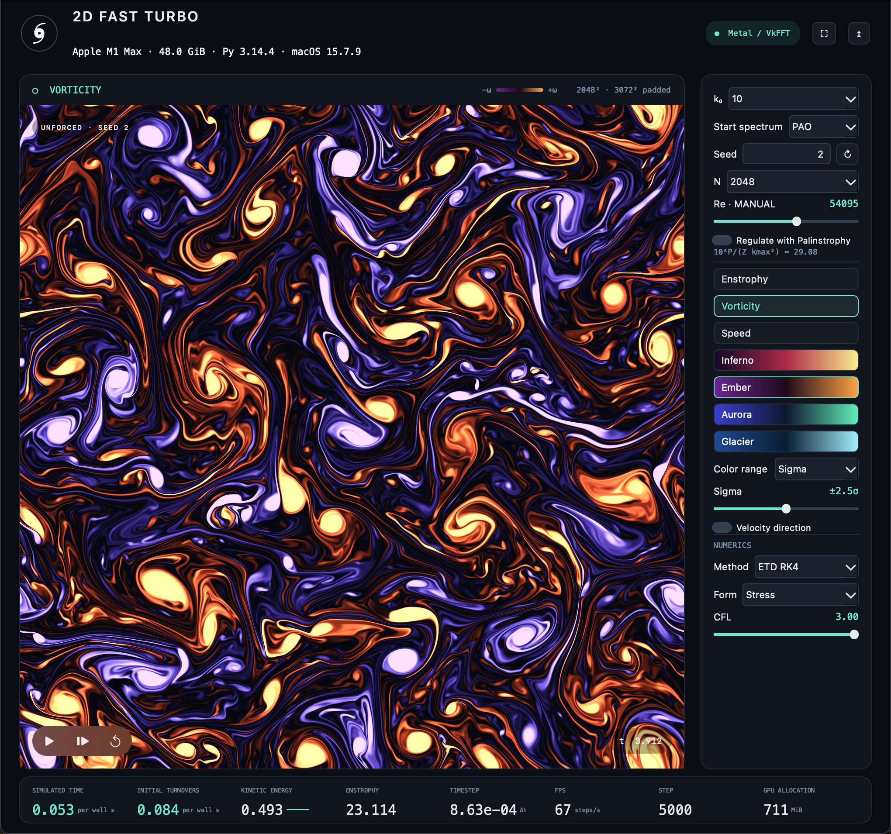

# 2DFastTurbo Python

A shared Python-hosted turbulence application for macOS, Windows and Linux, using
native Swift/Metal/VkFFT or C++/CUDA/VkFFT backends. Python supplies the PySide6 controls;
all CFD timesteps, FFTs, buffers and high-rate field rendering stay native.

For the same headless, time-based benchmark on each supported machine:

```sh
cd python
uv run 2dbench
```

This measures the production solver at retained 2048² and 4096² for 20 seconds
each, with normal 3/2 padding, automatic backend/device metadata and one compact
comparison table. Use `--seconds 2` for a quick test or `--json` to archive a run.
See the [benchmark options and timing definition](python/README.md#run-a-benchmark).

Recorded headless `2dbench` results (milliseconds per simulation step):

| OS / GPU | 2048² → 3072² | steps/s | 4096² → 6144² | steps/s |
| --- | ---: | ---: | ---: | ---: |
| macOS / Apple M1 Max | 12.876 ms | 77.7 | 82.376 ms | 12.1 |
| Ubuntu / RTX 3090 | 4.854 ms | 206.0 | 21.689 ms | 46.1 |
| Windows / RTX 3090 | 4.943 ms | 202.3 | 21.806 ms | 45.9 |
| Windows / RTX 5090 | 1.498 ms | 667.6 | **12.152 ms** | **82.3** |
| Ubuntu / NVIDIA RTX PRO 6000 Blackwell Server Edition | **1.312 ms** | **762.0** | 12.293 ms | 81.3 |

The [RTX 5090 run](python/evidence/2dbench/rtx5090-windows.json), recorded on
2026-09-18 with Windows 10, CUDA 13.4 and VkFFT 1.3.4, achieved **3.30× / 1.79×**
the listed Windows RTX 3090 throughput at 2048² / 4096². These runs use the same
benchmark workload but different systems and CUDA versions. See the
[full benchmark comparison](python/2dbench.md) for workload details, relative
performance and the 4096/2048 timestep ratios.

On Linux, build and run **native `2dbench` without Python or uv**:

```sh
cmake -S . -B build-linux -DCMAKE_BUILD_TYPE=Release \
  -DCMAKE_CUDA_ARCHITECTURES=86 -DFASTTURBO_BUILD_NATIVE_GUI=OFF
cmake --build build-linux --target 2dbench -j2
./build-linux/2dbench
```

It uses the same workload, options and JSON report as the Python command. Requires
CMake 3.26+, a CUDA-compatible C++20 compiler, CUDA Toolkit 13.x and an NVIDIA GPU
with a compatible driver. Use architecture `90` for H100 or `'86;90'` for both.
See [native benchmark build, installation and timing](reference-linux/2dbench.md).

A native **Dear ImGui Linux desktop**, with no Python or Qt runtime, is also
available. It uses the same CUDA/VkFFT solver and the existing CUDA/OpenGL
renderer:

```sh
cmake -S . -B build-linux -DCMAKE_BUILD_TYPE=Release \
  -DCMAKE_CUDA_ARCHITECTURES=86 -DFASTTURBO_BUILD_NATIVE_GUI=ON
cmake --build build-linux -j2
./fastturbo-linux
```

The Linux frontend follows [GUI.png](GUI.png), with File/Edit/Simulation/View/Window
menus, a centered square field, a compact scrolling right inspector, transport
overlays, focus mode and DPI scaling. See [native Linux setup, controls and validation](native-linux/README.md).
The presentation path is X11/GLX, through XWayland on Wayland desktops. For a
compute-only build without GUI dependencies, set `-DFASTTURBO_BUILD_NATIVE_GUI=OFF`.
The Python/PySide6 application and canonical `reference-linux` remain available.

Validated platform and GPU configurations from the shared `main` branch:

```text
                         main
                           │
          ┌────────────────┼────────────────┐
          │                │                │
        macOS            Linux           Windows
          │                │                │
        Metal             CUDA             CUDA
          │                │                │
        VkFFT             VkFFT            VkFFT
          │                │                │
       M1 Max           RTX 3090         RTX 3090
          ✓                ✓                ✓
```

Live field rendering uses Metal on macOS, Direct3D 11 on Windows, and OpenGL
on Linux. The macOS canvas supports EDR highlights; PNG exports use SDR sRGB.
Linux headless and GUI execution are validated on native Ubuntu 26.04.1 / RTX 3090,
with Qt xcb and an embedded GLX surface through Xwayland. The earlier WSLg CUDA
graphics-sharing limitation remains; native Wayland embedding is not supported.
See [LINUX_PORT.md](docs/LINUX_PORT.md) for setup and validation details.

For a native Linux GPU-server executable with no Python or desktop dependencies,
see [reference-linux](reference-linux/README.md). It shares the CUDA/VkFFT core,
validates the recorded Windows and macOS cases, supports the historical CNAB2
positional invocation, and benchmarks RTX 3090 (`sm_86`) or H100 (`sm_90`) builds.



*Captured on Apple M1 Max after exactly 5,000 iterations: 2048² grid, 3072² padded
workspace, and the native Metal / VkFFT backend.*

To run a published release with [uv](https://docs.astral.sh/uv/), without a
compiler or repository checkout:

```sh
uvx --python 3.13 --no-build --from fastturbo 2dfastturbo
```

The [PyPI release](https://pypi.org/project/fastturbo/) supplies wheels for Apple
Silicon macOS and Windows x64. They include the native engine; the Windows wheel
also includes CUDA runtime libraries and NVRTC. No Xcode or CUDA Toolkit is
needed to run a wheel. Windows still requires a compatible NVIDIA driver.
The next release layout adds a selected Linux `manylinux_2_28_x86_64` CUDA wheel
and a self-contained sdist for local Linux builds. See the
[publishing guide](python/PUBLISHING.md) for the container build and validation.
Published wheels are release snapshots; use the checkout below for
the latest changes on `main`.

The Python application requires **Python 3.13+** on all platforms. Its source
builds also require uv and the following platform tools:

| Platform | Runtime hardware / OS | Source-build requirements |
| --- | --- | --- |
| macOS | Apple Silicon, macOS 15+ | Xcode with Swift and the Metal compiler toolchain |
| Windows | Windows 10/11 x64, compatible NVIDIA GPU/driver | CUDA Toolkit 13.x (validated with 13.0), MSVC x64 C++ tools, CMake 3.26+, Ninja |
| Linux | NVIDIA GPU/driver; validated on Ubuntu 26.04.1 x86_64 / RTX 3090 | CUDA Toolkit 13.x (validated with 13.3.1), a compatible C++ compiler, CMake 3.26+, Ninja; desktop builds also need OpenGL, X11 and libpng development files plus Qt xcb runtime libraries |

The default CUDA build target is compute capability **8.6** (RTX 3090).
Other targets require an explicit build configuration; see the platform reports.
There is no CPU solver fallback.

With the prerequisites installed, run the current source from the repository root:

```sh
cd python
uv run 2dfastturbo
# Equivalent:
uv run python -m fastturbo
```

The first source launch builds the native library automatically. Keep both
reference trees in a source checkout: the builders reuse native sources and
vendored VkFFT headers from them. Installed wheels are self-contained.

Default retained resolution is **2048²**, with the classical **3072² padded**
nonlinear workspace. The default is ETD RK4, stress form, CFL 3, k₀=10, seed 2,
with palinstrophy regulation off.
Enable **Regulate with Palinstrophy** to adjust the Reynolds number automatically.
Changing N or k₀ recalculates the initial Re from the calibration formula in either mode.

Space pauses/resumes, Right advances one step, R resets, Cmd-Shift-R increments
the seed, F focuses the flow, and Cmd-S exports a PNG. On Windows and Linux, use
Ctrl in place of Cmd. The title-bar close button quits the application and stops
the simulation on all three platforms. Minimizing keeps the simulation running.
**File → Close Window** also quits on macOS and Linux; on Windows it hides the
window to the notification area, where the tray icon can reopen the retained run.
Press **Ctrl+Q on Windows or Linux** or **Cmd+Q on macOS** to quit the application.

Windows build, test and run from the repository root:

```powershell
powershell -ExecutionPolicy Bypass -File python/scripts/build-windows.ps1
powershell -ExecutionPolicy Bypass -File python/scripts/test-windows.ps1
powershell -ExecutionPolicy Bypass -File python/scripts/run-windows.ps1
```

The portable Windows ZIP is generated under `python/dist/` by
`python/scripts/package-windows.ps1`; it includes Python, Qt and native runtimes.
See the [Windows port report](docs/WINDOWS_PORT.md), [GUI parity matrix](docs/GUI_PARITY.md)
and [Windows validation evidence](python/evidence/windows/validation.json).
Set `CUDA_PATH` if the Windows toolkit is installed outside the default
CUDA 13.0 directory.

Linux build, test and run from the repository root, after installing the
prerequisites above:

```sh
# Point this at your installed CUDA 13.x toolkit.
export CUDA_HOME=/usr/local/cuda-13.3
export FASTTURBO_LINUX_RENDERER=ON
bash python/scripts/build-linux.sh
bash python/scripts/test-linux.sh             # Headless tests and native CTest
bash python/scripts/test-linux.sh --gui       # Full suite on a visible desktop
bash python/scripts/run-linux.sh
```

The GUI selects Qt's `xcb` platform for X11/Xwayland. `FASTTURBO_LINUX_RENDERER=ON`
requires all desktop build dependencies; the default `AUTO` builds the renderer
when they are present. Use `OFF` for a compute-only build. A headless run needs
no display or Qt initialization:

```sh
# From the repository root; also works with a desktop-enabled build.
bash python/scripts/run-linux.sh --headless --resolution 1024 --reynolds 50000 \
  --k0 4 --steps 200
```

Linux PNG export currently requires the renderer and an X11/Xwayland display.
See the [Linux port report](docs/LINUX_PORT.md) for environment setup, renderer options
and the H100 build target; H100 execution has not been validated.

macOS validation, starting from the repository root, builds the Swift reference
used for numerical comparisons and runs the Python suite, including GUI controls:

```sh
cd python
uv run python scripts/build_reference.py
uv run pytest -q
```

GUI tests on every platform require a visible desktop. Optional large-grid
checks use `uv run python scripts/check_gui.py --all-resolutions` from `python/`,
or `-AllResolutions` on the Windows test script. They now include grids through
**N=16384** and require substantial GPU memory. The recorded Linux RTX 3090
(24 GiB) run reached N=9216, then failed allocation at N=12288; N=16384 was not
reached. These checks are not part of the routine commands above.

To build a self-contained, locally signed macOS app, run from `python/`:

```sh
uv run python scripts/package_app.py
open 'dist/2DFastTurbo Python.app'
```

The `.app` includes Python, Qt, the native engine and shaders. It needs no terminal,
uv, Xcode or repository checkout at runtime. It is locally signed, not notarized
for public distribution. No app is installed into `/Applications` automatically.

To build a source archive and a wheel for the current platform, run from `python/`:

```sh
uv build
```

Build macOS and Windows wheels on their respective platforms. Build portable
Linux wheels with `python/packaging/manylinux.Dockerfile` from the sdist, then
audit and repair them. A local `linux_x86_64` wheel uses system libraries and is
not a portable PyPI artifact. The source archive includes the native code needed
for a fallback Linux build without a repository checkout.

[Reference contract](docs/PORT_REFERENCE.md) · [Architecture](docs/ARCHITECTURE.md) ·
[Measured performance and validation](docs/PERFORMANCE.md) · [Python API](python/README.md)

Recorded validation and performance results are dated below; they describe the
tested revisions and hardware, rather than a fresh run on every platform.

**macOS — 2026-09-14, M1 Max:** five matched benchmark pairs measured 0.40%
headless overhead; native GPU step times matched within 0.02%. Live Python
throughput was 1.52% higher in this sample, with about 60 presented frames/s.
All paired endpoint spectra were byte-identical. The GUI's **FPS** statistic
reports simulation steps/s, separately from display presentation rate.

**Windows — 2026-09-14, RTX 3090 / CUDA 13.0:** headless time overhead was 0.52%
at N1024 and 0.33% at N2048; visible GUI timings were within 1% of native.
The recorded gate passed 52 Python tests, two native CTest checks and 57 GUI
checks. Native numerical comparisons were bitwise equal. These historical
all-resolution results predate the larger grid choices.

**Linux — 2026-09-17, Ubuntu 26.04.1 / RTX 3090 / CUDA 13.3.1:** the latest
[recorded full suite](python/evidence/linux-window-close/REPORT.md) passed
**53 tests**, with 12 Windows-only skips and 1/1 native CTest checks passing.
Closing the live GUI exited the process and released its GPU resources.
The [clean-build validation](python/evidence/linux-clean-build/REPORT.md)
also passed 52 GUI assertions and 24 independent pixel comparisons.

The latest Linux clean-build benchmark medians were **719.831 headless / 664.224
GUI steps/s at N1024**, and **184.014 / 166.163 at N2048**. These compare GUI and
headless operation, unlike the Python-versus-native comparisons above. The stored
Windows trajectory matched within the existing 3 ppm diagnostic tolerance;
Linux spectra matched its independently invoked native reference byte-for-byte.

See [PERFORMANCE.md](docs/PERFORMANCE.md) for workload definitions, raw evidence and
measurement limits. Different dates, drivers and toolchains prevent these figures
from isolating an operating-system performance difference.
