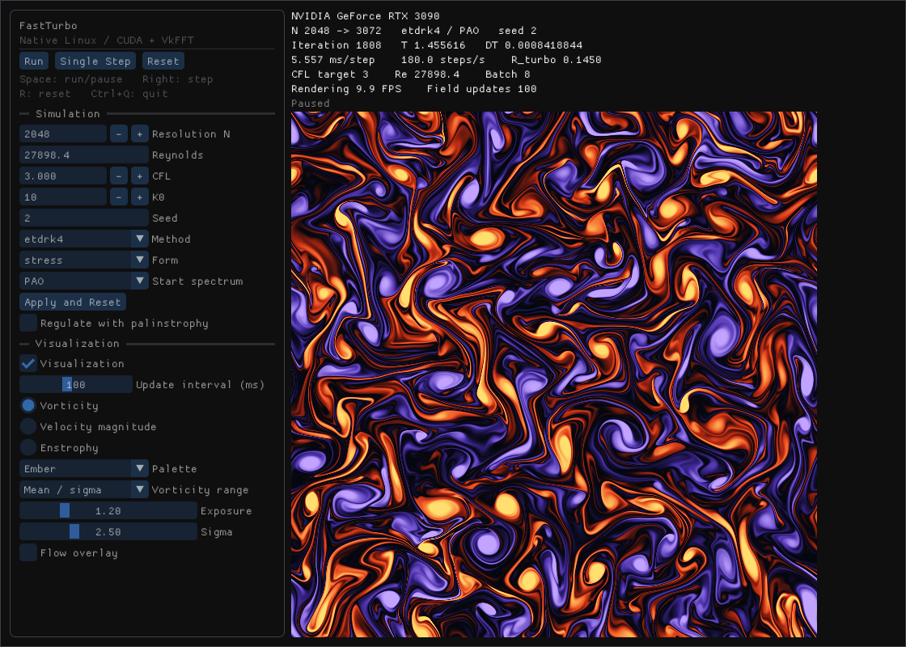

# Native Ubuntu Dear ImGui validation — 2026-09-20

The native application is built and runnable from the repository root with
`./fastturbo-linux`. The implementation is a thin C++ frontend over the existing
CUDA/VkFFT solver and Linux OpenGL renderer. It introduces no numerical solver,
kernel, FFT wrapper, initializer, or benchmark implementation.

## Implementation

- `native-linux/CMakeLists.txt`: pinned upstream Dear ImGui 1.92.5, static GUI
  dependencies, native executable, install component and opt-in desktop tests.
- `native-linux/main.cpp`: controls, telemetry, GPU texture display, acceptance
  test and existing controller benchmark orchestration.
- `native-linux/x11_imgui.{hpp,cpp}`: X11 input, UTF-8 text/clipboard, cursors,
  resize/close messages, and event-aware presentation waiting.
- `native-linux/tests/`: CLI checks and display-independent production-controller
  checks. `scripts/compare.py` orchestrates existing benchmark paths.
- `python/native/linux/render_api.hpp` / `renderer.cpp`: a small optional
  standalone desktop interface, reusing the current upload, shaders and GLX
  context. Existing embedding and PNG APIs retain their behavior.
- Root CMake adds the optional GUI target; the root launcher, README,
  `ARCHITECTURE.md`, and `native-linux/README.md` document build/run and ownership.

The generated native controller differs from the shared adaptation only in
configurable snapshot cadence and readiness without visualization. Its solver
worker, batches, timesteps, regulation and memory ownership remain existing
code. The Windows/macOS implementations, numerical sources, field shaders,
shared controller adapter and pre-existing tests were not edited.
[Authoritative source hashes](source-parity.json).

## Environment and dependencies

Ubuntu 26.04.1 LTS; NVIDIA RTX 3090 (24 GiB), driver 595.91.07; CUDA Toolkit
13.3.1 (nvcc 13.3.73), VkFFT 1.3.4; GCC 15.2.0; CMake 4.4.3; Release, sm_86.
The driver reports CUDA API version 13.2. No driver/toolkit/package was changed.
[Environment record](environment.json).

Desktop development packages already present:

| Package | Installed version |
| --- | --- |
| libx11-dev | 2:1.8.13-1 |
| libgl-dev | 1.7.0-3 |
| libglx-dev | 1.7.0-3 |
| libpng-dev | 1.6.57-1 |
| xwayland (runtime) | 2:24.1.10-1 |

Dear ImGui 1.92.5 comes from the upstream tag archive, SHA-256
`0eb50fe9aeba1a51f96b5843c7f630a32ed2e9362d693c61b87e4fa870cf826d`.
Its core and OpenGL3 backend are linked statically. Windowing uses the existing
X11/GLX infrastructure, with no GLFW, SDL, Qt or GTK requirement.

## Rendering and display

Actual path: **CUDA solver → immutable GPU Frame → existing CUDA/OpenGL
device-to-device upload into a GL texture buffer → unchanged field shaders →
OpenGL RGBA8 texture → Dear ImGui image → GLX window**.

`cudaGLGetDevices` verifies the CUDA/GL device match. An interop-stream wait
protects the source lease and registered buffer; there is no new per-step or
device-wide synchronization. Visualization defaults to 100 ms, while the
existing worker advances independently. Disabling visualization suppresses
snapshot extraction entirely. Normal presentation performs no CPU field/pixel
readback. Acceptance checks and requested captures explicitly read pixels.

This is native Ubuntu, with `DISPLAY=:0`, `WAYLAND_DISPLAY=wayland-0`, and a
GNOME **remote Wayland user session** (`REMOTE=1`). The presentation path is
**XWayland / GLX**, with OpenGL identifying the RTX 3090. GPU execution and
sharing are local to that GPU; remote presentation is not a physical-console
rendering benchmark. The local-monitor presentation rate remains unmeasured.
The [NVIDIA process listing](native-gpu-process.txt) identifies the native ELF
as **C+G** on the RTX 3090 (3,016 MiB during an N4096 run).

## Validation

- **133 existing pytest checks passed; 18 platform-only checks skipped** (six
  macOS, twelve Windows), in 138.39 s. Includes numerical/legacy/KM3 parity,
  all existing Linux tests, PySide6 controls, native Linux pixel comparisons,
  and the display-independent reference tests. Existing tolerances are unchanged.
  [Full log](pytest.log), [JUnit](pytest.xml).
  The recorded Windows trajectory's maximum relative diagnostic error was
  **1.87214449e-6**, below the unchanged **3e-6** tolerance.
  [Trajectory comparison](python/windows-parity.json).
- **9/9 Release CTest checks passed**: six existing reference/benchmark checks,
  native CLI, native controller, and real native desktop acceptance.
  [Log](ctest.log), [Detailed output](ctest-details.log), [JUnit](ctest.xml).
- The native controller matches direct production solver diagnostics for all
  four methods, checks pause/step/reset, velocity leases while paused, autonomous
  progress and configurable/disabled snapshot extraction without a display.
- Desktop acceptance uses actual X11 events through ImGui. It verifies startup,
  Run, stable Pause, exactly one Single Step, deterministic Reset, three distinct
  GPU field images, resize larger/smaller, disabling/restoring visualization,
  and window close while the solver is running. The process exits successfully.
  [Desktop result](desktop-test.json).
- Headless `2dbench` runs explicitly unset display variables. The existing
  headless-library test also rejects accidental Qt/graphics library loading.
- A fresh compute-only CMake configuration succeeded with the GUI off, graphics
  package lookup disabled and FetchContent disconnected. Those package/download
  flags were unused, confirming the headless configuration never entered them.
  [Configure output](headless-configure.log).

Sandboxed GPU attempts reported no CUDA-capable device, and the initial network
fetch was blocked by DNS restrictions. GPU/display/dependency execution was
rerun with approved access outside the sandbox. No CPU fallback or mock desktop
was used. One new controller test initially used production CFL 3 for legacy
CNAB2; it was corrected to the existing CNAB2 default 0.25, with no solver or
numerical tolerance change.

## Reproduction commands

Working directory: `/home/tobbe/github/2DFastTurboPython`.

```sh
# Before source changes; display-independent Python benchmark.
env -u DISPLAY -u WAYLAND_DISPLAY uv run --project python 2dbench \
  --seconds 10 --json > native-linux/evidence/2dbench-before.json

cmake -S . -B build-linux -DCMAKE_BUILD_TYPE=Release \
  -DCMAKE_CUDA_ARCHITECTURES=86 -DFASTTURBO_NATIVE_GUI_TESTS=ON
cmake --build build-linux -j2
ctest --test-dir build-linux --output-on-failure \
  --output-junit /home/tobbe/github/2DFastTurboPython/native-linux/evidence/ctest.xml

env FASTTURBO_CUDA_ARCH=86 FASTTURBO_LINUX_RENDERER=ON \
  FASTTURBO_EVIDENCE_DIR=/home/tobbe/github/2DFastTurboPython/native-linux/evidence/python \
  FASTTURBO_REFERENCE_EVIDENCE=/home/tobbe/github/2DFastTurboPython/native-linux/evidence/reference \
  QT_QPA_PLATFORM=xcb python/.venv/bin/python -m pytest -q -ra \
  python/tests reference-linux/tests/test_reference.py \
  --junitxml=native-linux/evidence/pytest.xml

./fastturbo-linux --self-test --output native-linux/evidence/desktop-test.json \
  --capture native-linux/evidence/desktop.png
python3 native-linux/scripts/compare.py --runs 3 --seconds 10 --sizes 2048 4096
env -u DISPLAY -u WAYLAND_DISPLAY uv run --project python 2dbench \
  --seconds 10 --json > native-linux/evidence/2dbench-after.json
./fastturbo-linux --resolution 2048 --benchmark-seconds 10 --interval-ms 100 \
  --output native-linux/evidence/final-gui-run.json \
  --capture native-linux/evidence/native-2048.png

cmake --install build-linux --prefix /tmp/fastturbo-native-install --component native-gui
ldd build-linux/fastturbo-linux
ldd /tmp/fastturbo-native-install/bin/fastturbo-linux
cmake -S . -B /tmp/fastturbo-headless-config -DCMAKE_BUILD_TYPE=Release \
  -DCMAKE_CUDA_ARCHITECTURES=86 -DFASTTURBO_BUILD_NATIVE_GUI=OFF \
  -DCMAKE_DISABLE_FIND_PACKAGE_OpenGL=ON -DCMAKE_DISABLE_FIND_PACKAGE_X11=ON \
  -DCMAKE_DISABLE_FIND_PACKAGE_PNG=ON -DFETCHCONTENT_FULLY_DISCONNECTED=ON
git diff --check
```

[Configure](configure.log), [build](build.log), [install](install.log).
Performance subprocess arguments, working directory, return status, display and
timestamps are recorded alongside every raw result.

## Dependency audit

Both the build and installed executable resolve CUDA runtime/driver/NVRTC,
OpenGL/GLX/GLdispatch, X11/XCB, libpng/zlib, and system C/C++/math/loader libraries.
**No Python, CPython, PySide6, Qt or GTK libraries are linked.**
The installed executable retains `/usr/local/cuda-13.3/lib64` as its RUNPATH;
all installed dependencies resolve without `LD_LIBRARY_PATH`. Installation was
tested only under `/tmp`; no user/system installation was performed.
[Build ldd](ldd.txt), [installed ldd](ldd-installed.txt).

## Performance

Three rotating-order runs per mode/grid, 10 timed seconds each. Medians:

| Grid | Mode | ms/step | steps/s | Overhead |
| --- | --- | ---: | ---: | ---: |
| 2048² | Headless native 2dbench | 5.4272 | 184.26 | 0.00% |
| 2048² | Native GUI, visualization disabled | 5.4705 | 182.80 | 0.80% |
| 2048² | Native GUI, 100 ms updates | 5.5814 | 179.17 | 2.84% |
| 4096² | Headless native 2dbench | 24.2526 | 41.23 | 0.00% |
| 4096² | Native GUI, visualization disabled | 24.4142 | 40.96 | 0.67% |
| 4096² | Native GUI, 100 ms updates | 25.0869 | 39.86 | 3.44% |

Overhead is `100 * (mode wall ms/step / headless wall ms/step - 1)`.
Same production ETDRK4/stress solver, PAO, seed 2, K0=10, Re=27898.36614974335,
CFL 3, fixed batch 8. Headless keeps its eight-step warmup/reset; GUI uses the
existing controller’s two-second warmup/reset, periodic diagnostics, and
independent snapshots. Normal GUI runs performed real device-to-device uploads;
disabled runs recorded **zero snapshots and zero uploads**. The presentation
loop processes input immediately, otherwise drawing near 10 FPS with normal
updates and near 4 FPS when visualization is disabled.

[All measured runs and ranges](performance/comparison.json),
[exact subprocess commands](performance/commands.json), [console log](performance.log).
No concurrent test/solver workloads were run during these comparisons.
The desktop and remote-display services remained active; the GPU was warm
(85°C in the captured process listing). No clock, power, fan, driver or toolkit
settings were changed. These are session measurements, not fixed device specifications.



The final launcher/capture check is recorded separately in
[final-gui-run.json](final-gui-run.json); the comparison medians use the three
rotating-order runs above.

The original 60 Hz prototype measured 7.71% / 7.28% overhead at N2048/N4096.
The final host avoids repeated unchanged draws and waits through GLX replies
until input arrives or its presentation deadline expires. Solver execution was
unchanged during this presentation adjustment. Earlier measurements are retained
in `performance-60hz/` and `performance-wakeups/` as development evidence,
not as final results.

The requested display-independent `uv run --project python 2dbench --seconds 10 --json`
was run before and after the implementation:

| Grid | Before ms/step | After ms/step | Change |
| --- | ---: | ---: | ---: |
| 2048² | 5.4033 | 5.3972 | -0.11% |
| 4096² | 24.0854 | 24.1532 | +0.28% |

The changes are within the session’s measured run-to-run variation. No numerical
performance regression was observed. Both commands explicitly unset `DISPLAY`
and `WAYLAND_DISPLAY`; neither initializes a GUI.
[Before](2dbench-before.json), [after](2dbench-after.json), [comparison](before-after.json).

## Remaining limits

Physical-console rendering performance was not available in this remote session.
This implementation uses XWayland on Wayland and has no separate native Wayland
backend. WSLg interop remains unvalidated. The executable uses the local system
CUDA/graphics libraries; it is not a portable driver/runtime bundle. Large-grid
allocation remains limited by GPU memory, as in the existing backend.
