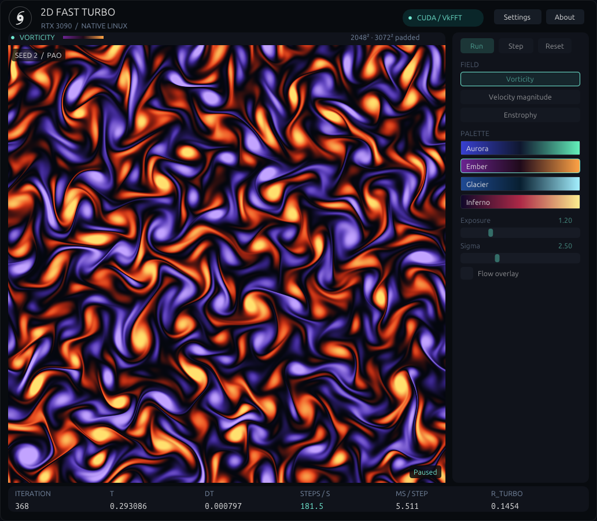

# Native Linux FastTurbo — Windows-style UI refinement

`./fastturbo-linux` now presents the complete **square field on the left**, a
**compact 236-pixel control sidebar on the right**, and live statistics below.
The default client size is **1032×900**, with a **756×756** field, fitting the
1440×1024 validation desktop. The square domain is never cropped or stretched;
wide/tall windows center the field and sidebar together. This follows the
user's final layout and sizing instructions.

[Windows/Linux side-by-side comparison](comparison.html). Design references were
[the native Windows capture](../../../reference-windows/benchmarks/2026-09-15/windows-gui.png),
Windows UI sources, and the supplied [GUI.png](../../../GUI.png).
The screenshot above is a real RTX 3090 framebuffer capture at N2048, using the
existing controller's timed mode; controls are temporarily disabled during that
benchmark. [Run metadata](final-gui-run.json).

The Windows design elements reproduced are the hurricane outline and circular
ring, near-black background, restrained rounded panels, mint highlights,
CUDA/VkFFT pill, field heading and palette legend, gradient palette buttons,
small seed label, and monospace metric values. Ubuntu system fonts replace the
ImGui default font. Controls use 14-pixel text and compact 25–26-pixel buttons at
100% scale. Advanced simulation and display settings occupy pages in the same
sidebar; detailed device/presentation information is in About.

Run/Pause, Step, Reset, three fields, all four existing palettes, Exposure,
Sigma and Flow overlay remain available. Settings retain N, Re, CFL, K0, seed,
method, form, PAO/KM3, regulation, vorticity range and update interval. Inactive
sliders reflect existing shader semantics: Exposure affects velocity, enstrophy
and full-range vorticity; Sigma affects mean/sigma vorticity. Numerical callbacks
and their validation remain unchanged.

Files changed:

- `native-linux/main.cpp`: compact sidebar, square responsive layout, typography,
  diagnostics, window/DPI options, and expanded real-X11 acceptance checks.
- `native-linux/theme.hpp`: theme, system-font fallbacks, existing Windows
  hurricane outline and palette-preview colors; no SVG or font runtime added.
- `native-linux/x11_imgui.{cpp,hpp}`: startup Xft.dpi lookup and acceptance-only
  keyboard/large-window helpers. Existing event wait/presentation pacing remains.
- `native-linux/README.md`: controls, layout, scaling and evidence documentation.
- `native-linux/evidence/windows-style/`: new measurements, screenshots and report.
  Earlier evidence is preserved.

The solver, kernels, FFT, timestepping, PAO, regulation, controller adaptation,
GPU ownership, Linux renderer/shaders and benchmark workload are unchanged.
[Source hashes and baseline comparison](source-parity.json). The rendering path
remains GPU-resident CUDA/VkFFT → existing CUDA/OpenGL interop → OpenGL texture →
Dear ImGui → X11/GLX. Normal rendering has no CPU field/pixel readback. The
presentation interval still defaults to 100 ms, independent of solver stepping.
A bounded GPU display target (1024 logical pixels per side, scaled for DPI)
limits rendering cost at large window sizes without changing simulation N.

Release validation:

- **9/9 CTest checks passed**, including existing reference/benchmark checks,
  native CLI, native controller and actual desktop acceptance. [Log](ctest.log),
  [JUnit](ctest.xml).
- **133 existing pytest checks passed, 18 platform-only checks skipped**, in
  155.29 seconds. Numerical/legacy/KM3/Windows parity and existing Linux GUI
  renderer tests used unchanged tolerances. The largest recorded Windows trajectory
  relative error was 1.87214449e-6, below the existing 3e-6 tolerance.
  [Log](pytest.log), [JUnit](pytest.xml),
  [Windows trajectory comparison](python/windows-parity.json).
- **40 desktop acceptance checks passed** through real X11 button/key events:
  startup, Run, stable Pause, exactly one Step, deterministic Reset, three
  distinct field images, four distinct palettes, Exposure/Sigma pixel changes,
  square layout, repeated resize, 200% scaling and restoration, N256 apply/reset,
  visualization off/on with independent stepping, About, Flow overlay on/off
  and a successful normal close while the solver runs. [Result](desktop-test.json).
- Layout captures: [1280×720](desktop-1280x720.png),
  [1920×1080](desktop-1920x1080.png),
  [3840×2160 at 200%](desktop-3840x2160-200pct.png),
  [1600×1200 at 200%](desktop-1600x1200-200pct.png),
  [settings](desktop-settings.png).

The GNOME remote desktop is **1440×1024**. Its window manager constrains larger
normal windows. Large-layout acceptance therefore uses actual GPU-backed X11
window buffers placed outside the visible desktop, bypassing those constraints;
these captures are not a physical 4K monitor test. DPI reads Xft.dpi at startup
and can be changed explicitly. Automatic per-monitor DPI switching is not
implemented. Maintaining the complete square domain leaves surrounding space
at wide aspect ratios, as requested.

Three rotating-order runs per mode and grid, 10 timed seconds each; medians:

| Grid | Mode | Before ms/step | After ms/step | Change | After overhead |
| --- | --- | ---: | ---: | ---: | ---: |
| 2048² | Headless native 2dbench | 5.4163 | 5.4437 | +0.50% | 0.00% |
| 2048² | Visualization off | 5.4554 | 5.4658 | +0.19% | 0.41% |
| 2048² | Normal visualization | 5.5938 | 5.5743 | -0.35% | 2.40% |
| 4096² | Headless native 2dbench | 24.1882 | 24.2741 | +0.36% | 0.00% |
| 4096² | Visualization off | 24.3829 | 24.3262 | -0.23% | 0.21% |
| 4096² | Normal visualization | 25.0005 | 24.9061 | -0.38% | 2.60% |

No material GUI regression was observed. Normal-GUI medians changed by -0.35%
(2048²) and -0.38% (4096²), within ordinary session variation. The unchanged
headless workload varied by +0.50% / +0.36%. This is not a solver optimization.
Normal visualization overhead is 2.40% / 2.60%, compared with 3.28% / 3.36% in
the fresh baseline. All visualization-off runs recorded zero snapshots and zero
uploads. No concurrent tests or solver workloads ran during the comparisons.

Overhead is `100 * (GUI wall ms/step / headless wall ms/step - 1)`. Both versions
use the unchanged production ETDRK4/stress workload, PAO, K0=10, seed 2,
Re=27898.36614974335, CFL 3, fixed batch 8, and 100 ms display updates. GUI runs
retain the existing controller's two-second warmup/reset; headless retains its
eight-step warmup/reset. Normal GUI runs use each version's default window.
These are RTX 3090 measurements in the same remote XWayland session, not a
physical-console presentation benchmark. No clock, power, fan or driver setting
was changed.

[Before runs/ranges](before/comparison.json), [after runs/ranges](after/comparison.json),
[before/after summary](before-after.json), [before commands](before/commands.json),
[after commands](after/commands.json).

`env -u DISPLAY -u WAYLAND_DISPLAY uv run --project python 2dbench --seconds 10 --json`
also passed: **5.4347 ms/step at 2048²**, **24.1684 ms/step at 4096²**.
[Headless benchmark result](2dbench.json), [build/runtime log](2dbench.log).

The executable remains **C++ / Dear ImGui / OpenGL / CUDA / VkFFT**.
[ldd audit](ldd.txt) resolves only CUDA/NVRTC, OpenGL/GLX, X11/XCB, libpng/zlib
and system C/C++ libraries. **No Python, CPython, PySide6, Qt or GTK runtime
dependency** was introduced, and no system package, driver or toolkit was changed.

[Exact validation commands](validation-commands.sh), [Release configure log](configure.log),
[build log](build.log). Performance subprocess arguments, timestamps and statuses
are saved with each comparison. The baseline executable was preserved before
UI changes with the checkout at `374871f` on `IMGUI_LINUX`. Its embedded
headless build metadata still names `25e1dfd`; reconfiguration updates that to
`4c4d4ed`. The headless source/workload is unchanged, while the ELF hashes differ
with rebuilt metadata. [Recorded binary hashes](binary-hashes.json).
