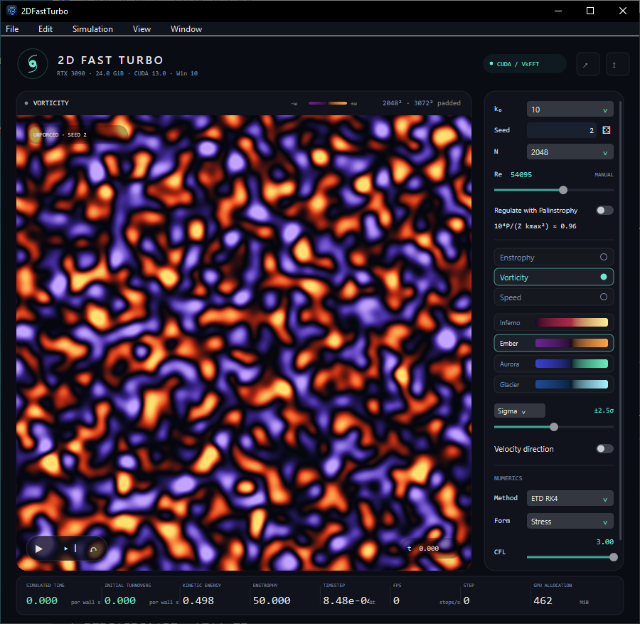

# 2D FAST TURBO for Windows

The native Windows port preserves the reference solver, control layout, fields,
palettes, transport behavior and diagnostics. N means retained resolution:
the GUI default N=2048 uses a 3072×3072 nonlinear workspace, with k₀=10,
calibrated Reynolds and palinstrophy regulation initially off. Benchmark
defaults remain N=1024 and k₀=4.



The native Windows interface follows the updated macOS/Python controls and
menus. Its header shows GPU, memory, CUDA and Windows details. File → About
includes the embedded Navier–Stokes equation. The resolution menu extends
through N=16384; usable sizes depend on available GPU memory.

## Portable release

Copy `reference-windows/dist/2DFastTurbo.exe` to another Windows 10/11 RTX PC and open it.
The distribution requires only Windows and a compatible NVIDIA driver with
CUDA 13 support (R580 or newer); it does not require a CUDA Toolkit or VC++
Redistributable installation. Runtime resources and NVRTC are embedded.
See [PACKAGING.md](PACKAGING.md) for the dependency audit and validation evidence.

Rebuild the distribution from the repository root:

```powershell
powershell -NoProfile -ExecutionPolicy Bypass -File reference-windows/scripts/package.ps1
```

## Development build and launch

Prerequisites: Windows 10 x64, an RTX 3090 with a CUDA 13 compatible NVIDIA
driver, CUDA Toolkit 13.0 at its standard installation path, Visual Studio 2022
C++ x64 tools with the Windows SDK, CMake 3.26+ and Ninja on PATH. Python/NumPy are
needed only for numerical validation. VkFFT 1.3.4 comes from the vendored
reference tree; the build does not download dependencies.

From the repository root in PowerShell:

```powershell
powershell -NoProfile -ExecutionPolicy Bypass -File reference-windows/scripts/build.ps1
powershell -NoProfile -ExecutionPolicy Bypass -File reference-windows/scripts/run.ps1
```

The executable is `reference-windows/build/2DFastTurbo.exe`. Shaders are embedded at build time.
The launcher supplies the CUDA DLL path and waits for the application. The
executable can also be opened directly when CUDA's `bin` is on PATH. This is
a native GUI executable, without a separate console window.

Space pauses/resumes, Right advances one step, R resets the same seed, F toggles
focus, Ctrl+S saves a 1800×1800 PNG, and Ctrl+Shift+R increments the seed. Closing
the window keeps the simulation running in the notification area. Click its
icon to reopen; choose Quit from its menu or press Ctrl+Q to exit. Minimize also
keeps computing. Ctrl+W closes to the tray and Ctrl+M minimizes. Sliders and seed
fields support keyboard focus; the Edit menu supports seed undo/redo and clipboard
actions. The tray also offers Pause/Resume.

See [the complete control contract](docs/REFERENCE.md) for defaults and ranges.
The actual macOS application has no drag, preset, fixed-dt or batch GUI controls.
Fixed timesteps and explicit batching remain command-line validation options.

## Validation

The [2026-09-15 GUI update evidence](benchmarks/2026-09-15/validation.json)
records 68 native GUI checks, the core CTest suite, and 12 Windows Python
compatibility tests. The portable EXE also passed with development paths removed.
Screenshots show the [default window](benchmarks/2026-09-15/windows-gui.png)
and [About dialog](benchmarks/2026-09-15/windows-about.png), captured on Windows 10
with an RTX 3090. Large-grid GUI behavior was exercised at N=3072; the highest
menu entries were not allocated on this machine.

The tests need the CUDA DLL directory on PATH when launching the executable
directly. NumPy can be installed entirely inside this workspace:

```powershell
$env:PATH = "C:/Program Files/NVIDIA GPU Computing Toolkit/CUDA/v13.0/bin;$env:PATH"
python -m pip install --target reference-windows/.python numpy
New-Item -ItemType Directory -Force reference-windows/artifacts/colors | Out-Null
ctest --test-dir reference-windows/build --output-on-failure
python reference-windows/tests/numerics.py
python reference-windows/tests/numerics.py --resolutions 128 --output reference-windows/artifacts/numerics-n128
python reference-windows/tests/native_reference.py
powershell -NoProfile -ExecutionPolicy Bypass -File reference-windows/scripts/run.ps1 --live-check --resolution 128 --output reference-windows/artifacts/gui-check.json --export reference-windows/artifacts/gui-field.png --capture reference-windows/artifacts/gui-window.png
powershell -NoProfile -ExecutionPolicy Bypass -File reference-windows/scripts/run.ps1 --gui-benchmark --resolution 32 --reynolds 50000 --until 0 --gui-warmup-seconds 0 --fields reference-windows/artifacts/colors/fields.f32 --render-check reference-windows/artifacts/colors --output reference-windows/artifacts/colors/run.json
python reference-windows/tests/render_reference.py
```

Create output directories before using explicit file paths. The numerical test
scripts create their own directories. The live check opens native menus and a
save dialog; leave its window foreground while it operates the controls.

The GUI/headless trajectory check uses the same initial condition, fixed dt,
20 steps and Reynolds number, with different batching and presentation:

```powershell
powershell -NoProfile -ExecutionPolicy Bypass -File reference-windows/scripts/run.ps1 --gui-benchmark --resolution 128 --reynolds 50000 --steps 20 --fixed-dt 0.001 --gui-warmup-seconds 0.1 --spectrum reference-windows/artifacts/gui-trajectory.c64 --output reference-windows/artifacts/gui-trajectory.json
powershell -NoProfile -ExecutionPolicy Bypass -File reference-windows/scripts/run.ps1 --benchmark --resolution 128 --reynolds 50000 --steps 20 --fixed-dt 0.001 --warmup 0 --spectrum reference-windows/artifacts/headless-trajectory.c64 --output reference-windows/artifacts/headless-trajectory.json
python reference-windows/tests/compare_execution.py
```

`--help` lists the CLI. Initial files contain N×N little-endian Float32 vorticity,
row-major. Spectral exports contain the full N×N little-endian complex64 array
of Fourier-series coefficients, including conjugate modes. `--fields` exports
three contiguous physical Float32 planes [vorticity,u,v]. These explicit exports
use CPU readback; ordinary display uses CUDA/Direct3D shared GPU buffers.

## Direct Metal comparison

The checked-in reference contains independent mathematical tests, but its Metal
endpoint spectra are absent. The provided capture scripts support a genuine
cross-platform comparison and verify fixture, source, endpoint and file hashes.

Run on Windows:

```powershell
python reference-windows/scripts/capture_reference.py --app reference-windows/build/2DFastTurbo.exe --output reference-windows/artifacts/captures/windows
```

On a Mac with this repository and NumPy installed, build the unmodified reference
and capture the same 36 cases from the repository root:

```sh
(cd reference-macos/2DFastTurbo && bash Scripts/build.sh)
python3 reference-windows/scripts/capture_reference.py --app /tmp/2DFastTurboDerived/Build/Products/Release/2DFastTurbo.app/Contents/MacOS/2DFastTurbo --output reference-windows/artifacts/captures/macos
```

Copy the Mac capture directory to Windows, then run:

```powershell
python reference-windows/scripts/compare_captures.py --macos reference-windows/artifacts/captures/macos --windows reference-windows/artifacts/captures/windows --output reference-windows/artifacts/metal-cuda-comparison.json
```

The default relative tolerance is 3e-5 for vorticity, energy and enstrophy. The
comparator requires actual Darwin and Windows captures from identical reference
source revisions. Mathematical-reference agreement is reported separately.
The recorded Windows captures are also preserved in
`benchmarks/2026-09-13/windows-captures.zip`, including their original provenance.

## Benchmark

```powershell
powershell -NoProfile -ExecutionPolicy Bypass -File reference-windows/scripts/benchmark.ps1 -Runs 3 -Seconds 5
```

This interleaves headless and visible GUI runs, with N=1024, M=1536, seed=2,
k₀=4, fixed Re=50000, CFL=3, ETDRK4 and stress formulation. Each run restarts
from the same state after warmup. Results and screenshots go into
`reference-windows/artifacts/benchmark`. Leave the GUI visible during measurement.

[The port report](docs/PORT_REPORT.md) records the measured machine, validation,
performance and remaining differences. Small evidence files are preserved in
`reference-windows/benchmarks/2026-09-13`; large raw fields and local dependencies are ignored.
