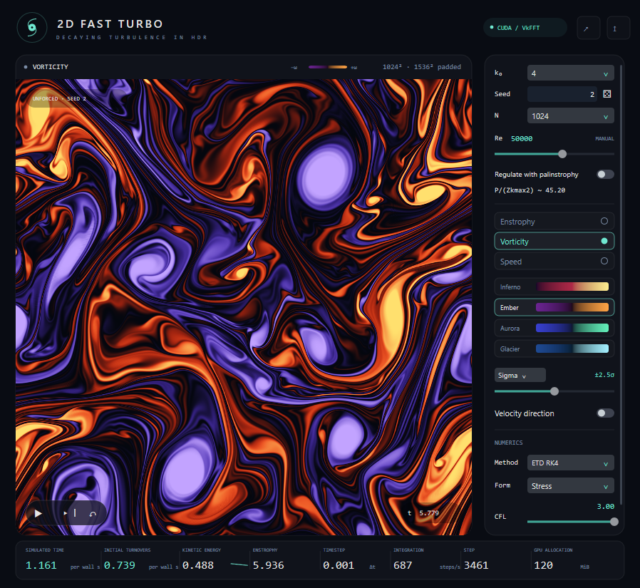

# 2D FAST TURBO for Windows

The native Windows port preserves the reference solver, control layout, fields,
palettes, transport behavior and diagnostics. N means retained resolution:
the default N=1024 uses a 1536×1536 nonlinear workspace.



## Portable release

Copy `windows/dist/2DFastTurbo.exe` to another Windows 10/11 RTX PC and open it.
The distribution requires only Windows and a compatible NVIDIA driver with
CUDA 13 support (R580 or newer); it does not require a CUDA Toolkit or VC++
Redistributable installation. Runtime resources and NVRTC are embedded.
See [PACKAGING.md](PACKAGING.md) for the dependency audit and validation evidence.

Rebuild the distribution from the repository root:

```powershell
powershell -NoProfile -ExecutionPolicy Bypass -File windows/scripts/package.ps1
```

## Development build and launch

Prerequisites: Windows 10 x64, an RTX 3090 with a CUDA 13 compatible NVIDIA
driver, CUDA Toolkit 13.0 at its standard installation path, Visual Studio 2022
C++ x64 tools with the Windows SDK, CMake 3.26+ and Ninja on PATH. Python/NumPy are
needed only for numerical validation. VkFFT 1.3.4 comes from the vendored
reference tree; the build does not download dependencies.

From the repository root in PowerShell:

```powershell
powershell -NoProfile -ExecutionPolicy Bypass -File windows/scripts/build.ps1
powershell -NoProfile -ExecutionPolicy Bypass -File windows/scripts/run.ps1
```

The executable is `windows/build/2DFastTurbo.exe`. Shaders are embedded at build time.
The launcher supplies the CUDA DLL path and waits for the application. The
executable can also be opened directly when CUDA's `bin` is on PATH. This is
a native GUI executable, without a separate console window.

Space pauses/resumes, Right advances one step, R resets the same seed, F toggles
focus, Ctrl+S saves a 1800×1800 PNG, and Ctrl+Shift+R increments the seed. Closing
the window keeps the simulation running in the notification area. Click its
icon to reopen; choose Quit from its menu or press Ctrl+Q to exit. Minimize also
keeps computing. Sliders and seed fields support keyboard focus.

See [the complete control contract](docs/REFERENCE.md) for defaults and ranges.
The actual macOS application has no drag, preset, fixed-dt or batch GUI controls.
Fixed timesteps and explicit batching remain command-line validation options.

## Validation

The tests need the CUDA DLL directory on PATH when launching the executable
directly. NumPy can be installed entirely inside this workspace:

```powershell
$env:PATH = "C:/Program Files/NVIDIA GPU Computing Toolkit/CUDA/v13.0/bin;$env:PATH"
python -m pip install --target windows/.python numpy
New-Item -ItemType Directory -Force windows/artifacts/colors | Out-Null
ctest --test-dir windows/build --output-on-failure
python windows/tests/numerics.py
python windows/tests/numerics.py --resolutions 128 --output windows/artifacts/numerics-n128
python windows/tests/native_reference.py
powershell -NoProfile -ExecutionPolicy Bypass -File windows/scripts/run.ps1 --live-check --resolution 128 --output windows/artifacts/gui-check.json --export windows/artifacts/gui-field.png --capture windows/artifacts/gui-window.png
powershell -NoProfile -ExecutionPolicy Bypass -File windows/scripts/run.ps1 --gui-benchmark --resolution 32 --reynolds 50000 --until 0 --gui-warmup-seconds 0 --fields windows/artifacts/colors/fields.f32 --render-check windows/artifacts/colors --output windows/artifacts/colors/run.json
python windows/tests/render_reference.py
```

Create output directories before using explicit file paths. The numerical test
scripts create their own directories. The live check opens native menus and a
save dialog; leave its window foreground while it operates the controls.

The GUI/headless trajectory check uses the same initial condition, fixed dt,
20 steps and Reynolds number, with different batching and presentation:

```powershell
powershell -NoProfile -ExecutionPolicy Bypass -File windows/scripts/run.ps1 --gui-benchmark --resolution 128 --reynolds 50000 --steps 20 --fixed-dt 0.001 --gui-warmup-seconds 0.1 --spectrum windows/artifacts/gui-trajectory.c64 --output windows/artifacts/gui-trajectory.json
powershell -NoProfile -ExecutionPolicy Bypass -File windows/scripts/run.ps1 --benchmark --resolution 128 --reynolds 50000 --steps 20 --fixed-dt 0.001 --warmup 0 --spectrum windows/artifacts/headless-trajectory.c64 --output windows/artifacts/headless-trajectory.json
python windows/tests/compare_execution.py
```

`--help` lists the CLI. Initial files contain N×N little-endian Float32 vorticity,
row-major. Spectral exports contain the full N×N little-endian complex64 array
of Fourier-series coefficients, including conjugate modes. `--fields` exports
three contiguous physical Float32 planes [vorticity,u,v]. These explicit exports
use CPU readback; ordinary display uses CUDA/Direct3D shared GPU buffers.

## Direct Metal comparison

The checked-in reference contains independent mathematical tests, but its Metal
endpoint spectra are absent. The provided capture scripts support a genuine
cross-platform comparison and verify fixture, source, endpoint and file hashes.

Run on Windows:

```powershell
python windows/scripts/capture_reference.py --app windows/build/2DFastTurbo.exe --output windows/artifacts/captures/windows
```

On a Mac with this repository and NumPy installed, build the unmodified reference
and capture the same 36 cases from the repository root:

```sh
(cd reference-macos/2DFastTurbo && bash Scripts/build.sh)
python3 windows/scripts/capture_reference.py --app /tmp/2DFastTurboDerived/Build/Products/Release/2DFastTurbo.app/Contents/MacOS/2DFastTurbo --output windows/artifacts/captures/macos
```

Copy the Mac capture directory to Windows, then run:

```powershell
python windows/scripts/compare_captures.py --macos windows/artifacts/captures/macos --windows windows/artifacts/captures/windows --output windows/artifacts/metal-cuda-comparison.json
```

The default relative tolerance is 3e-5 for vorticity, energy and enstrophy. The
comparator requires actual Darwin and Windows captures from identical reference
source revisions. Mathematical-reference agreement is reported separately.
The recorded Windows captures are also preserved in
`benchmarks/2026-09-13/windows-captures.zip`, including their original provenance.

## Benchmark

```powershell
powershell -NoProfile -ExecutionPolicy Bypass -File windows/scripts/benchmark.ps1 -Runs 3 -Seconds 5
```

This interleaves headless and visible GUI runs, with N=1024, M=1536, seed=2,
k₀=4, fixed Re=50000, CFL=3, ETDRK4 and stress formulation. Each run restarts
from the same state after warmup. Results and screenshots go into
`windows/artifacts/benchmark`. Leave the GUI visible during measurement.

[The port report](docs/PORT_REPORT.md) records the measured machine, validation,
performance and remaining differences. Small evidence files are preserved in
`windows/benchmarks/2026-09-13`; large raw fields and local dependencies are ignored.
